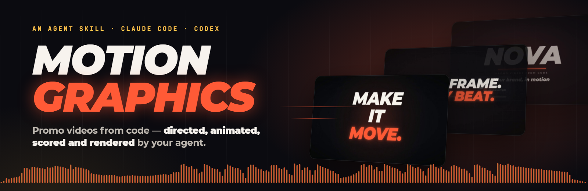
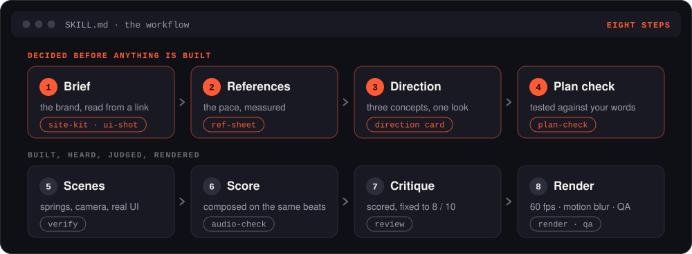
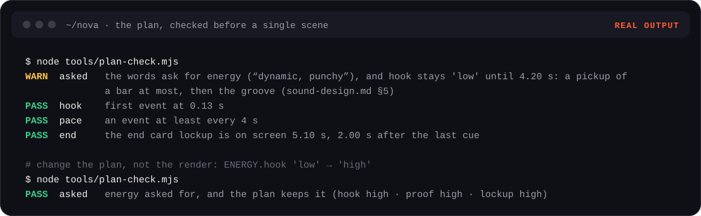
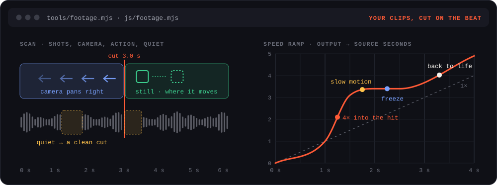
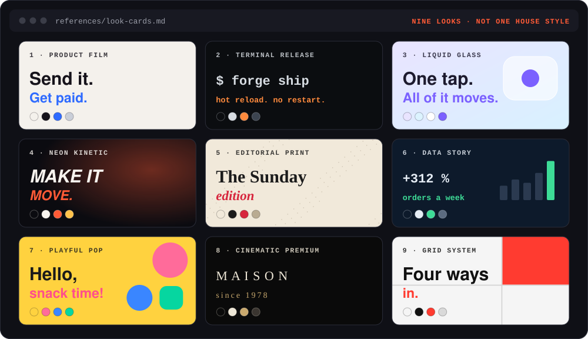
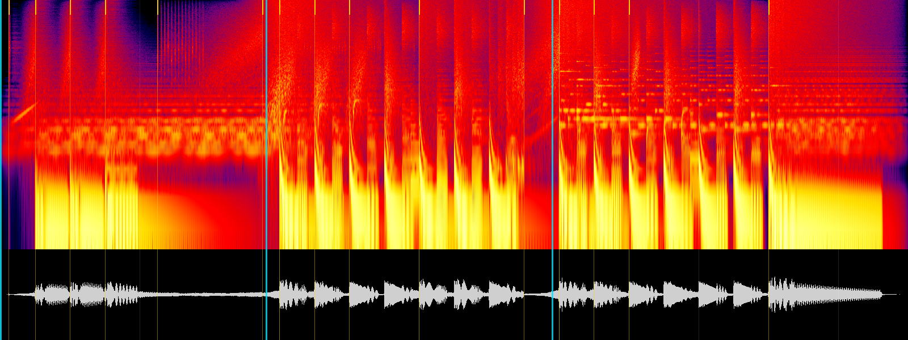

 

Give your agent a link, a repo, screenshots or your own clips, and ask for a video. It directs the film, animates it
in code, composes an original chillout or downtempo score and renders the MP4.

## What it does

- **Directs before it builds** — three concepts, one of nine looks, a plan checked against your words.
- **Reads your brand from a link** — the real interface, logo, colours, fonts and prices.
- **Animates in code** — springs, a moving camera, sub-frame motion blur, 60 fps.
- **Cuts your footage on the beat** — speed ramps, whips, freezes, captions.
- **Scores every video** — an original chillout-family soundtrack, shaped for the brand and the edit.
- **Critiques itself** — fixes the worst until every score is 8 / 10, then checks every frame.

## How it works

One file holds the film: the scenes, how hard each one hits, and every hit as a named cue on the beat grid. The
picture and the score are both built from it — the drop lands on the brand, the silence before the logo is real.

## The plan is checked first

Your words set the energy. The score keeps its chillout character while the arrangement becomes sparser or fuller.

## Your footage

The scan finds the cuts, the camera's direction, the action and the quiet between phrases. The edit lands on the beat.

## Nine looks

## Sound

A score composed for each video from a built-in synth, checked by eye against its cues, fingerprinted against your
earlier videos. Chillout, chillhop, ambient and gentle downtempo are the default music family.

## Install

The skill is in [`skills/chillout-motion-graphics`](skills/chillout-motion-graphics). Copy that folder into the
skills directory supported by your agent. The Claude Code plugin manifest is in `.claude-plugin/`.

## Use

> Here's our site — a 20-second launch promo for X, energetic.

> A 6-second logo sting for my channel, logo attached. Heavy, cinematic.

> Clips from a trip, attached — a vertical reel with bold transitions.

You get `out/<name>.mp4` (60 fps, −14 LUFS), covers, a light copy for messengers and a project that re-renders with
one command. Facts come only from you or your site's public pages; references are studied, never copied.

## Requirements

Node.js 22.4+, ffmpeg, and Chrome, Edge or Chromium. No npm packages, API keys, stock footage or AI video.

## License

[MIT](LICENSE). This project adapts code from [Mort1d/motion-graphics-skills](https://github.com/Mort1d/motion-graphics-skills);
see [NOTICE.md](NOTICE.md) for attribution. Bundled fonts: Montserrat and JetBrains Mono, SIL Open Font License 1.1
([OFL.txt](skills/chillout-motion-graphics/assets/template/assets/fonts/OFL.txt)).

## Maintainer

[ChainZenit on X](https://x.com/ChainZenit)
